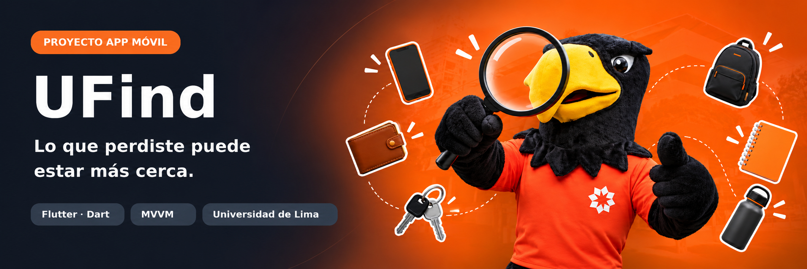

<div align="center">



<br />


### 🔎 Encuentra lo que perdiste. Ayuda a que otros recuperen lo suyo.

**UFind** es una aplicación móvil académica diseñada para facilitar la consulta, localización y recuperación de objetos encontrados dentro de la **Universidad de Lima**.

[Descripción](#-descripción-de-la-aplicación) · [Funcionalidades](#-funcionalidades) · [Pantallas](#-pantallas) · [Navegación](#-flujo-de-navegación) · [Tecnologías](#-tecnologías-utilizadas) · [Ejecutar](#-cómo-ejecutar-el-proyecto)

</div>

---

## 📌 Descripción de la aplicación

### ¿Qué es UFind?

**UFind** es un prototipo de aplicación móvil de **objetos perdidos y encontrados** que centraliza publicaciones de objetos hallados en el campus, facilita su búsqueda y permite enviar solicitudes de recuperación para revisión de Administración.

| | |
|:--|:--|
| **Nombre** | UFind |
| **Ámbito** | Universidad de Lima |
| **Tipo de solución** | Aplicación móvil desarrollada con Flutter |
| **Público objetivo** | Estudiantes y personal administrativo de la universidad |
| **Modalidad actual** | Prototipo académico con datos y accesos locales de demostración |

### 🎯 Problema que busca resolver

Cuando una persona pierde un objeto dentro del campus, puede no saber si alguien lo encontró, dónde fue localizado o a quién acudir. Una consulta dispersa dificulta relacionar al propietario con los objetos recuperados.

**UFind propone un punto de consulta centralizado**: los objetos publicados pueden encontrarse por nombre, categoría, fecha y pabellón; después, el estudiante puede revisar la información y enviar una solicitud de recuperación.

### 👥 Público objetivo

- **Estudiantes:** consultan objetos encontrados, revisan su ubicación aproximada, gestionan su perfil y envían solicitudes.
- **Personal administrativo:** registra objetos, actualiza publicaciones y revisa solicitudes de recuperación.

> [!IMPORTANT]
> **Alcance del prototipo:** la aplicación funciona con información almacenada localmente en el dispositivo y con publicaciones de ejemplo. No cuenta todavía con autenticación institucional real, backend remoto ni sincronización entre celulares.

---

## ✨ Funcionalidades

<table>
<tr>
<td width="50%" valign="top">

### 🎓 Módulo estudiante

- ✅ Pantalla de bienvenida e ingreso de demostración.
- ✅ Creación y edición de un perfil local.
- ✅ Consulta de objetos encontrados.
- ✅ Búsqueda por texto, categorías y fechas.
- ✅ Visualización de fotografías y detalles de objetos.
- ✅ Consulta del mapa del campus agrupado por pabellones.
- ✅ Lista de objetos al seleccionar un pabellón.
- ✅ Envío y seguimiento de solicitudes de recuperación.
- ✅ Selección de tema claro, oscuro o del sistema.

</td>
<td width="50%" valign="top">

### 🛠️ Módulo administración

- ✅ Panel con resumen de publicaciones por estado.
- ✅ Registro de objetos con nombre, descripción, categoría y fecha.
- ✅ Selección de **pabellón mediante lista desplegable**, sin marcar ubicaciones manualmente.
- ✅ Fotografías desde cámara o galería.
- ✅ Edición y eliminación de publicaciones.
- ✅ Actualización de estados de los objetos.
- ✅ Revisión, aprobación y rechazo de solicitudes.
- ✅ Visualización de las ubicaciones en el mapa.

</td>
</tr>
</table>

### 🏗️ Arquitectura del proyecto

```text
Interfaz / Views (Flutter)
        │ eventos + escucha de cambios
        ▼
ViewModels (ChangeNotifier)
        │ operaciones sobre datos
        ▼
Repositories
        │ lectura y escritura
        ▼
Services (SharedPreferences / imágenes)
```

```text
lib/
├── app/           # Rutas, tema e inicialización de dependencias
├── demo/          # Publicaciones iniciales de ejemplo
├── models/        # Objeto, pabellón, solicitud y perfil
├── views/         # Pantallas estudiante, administrador, acceso y widgets
├── viewmodels/    # Estado y lógica de la interfaz
├── repositories/  # Acceso organizado a datos
└── services/      # Persistencia local, fotos y validaciones
```

<div align="center">

### 🧡 UFind

**Una forma más organizada de conectar objetos encontrados con sus propietarios.**

*Proyecto académico · Programación Móvil · Universidad de Lima*

</div>
